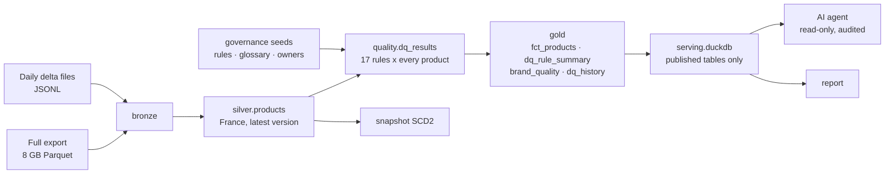
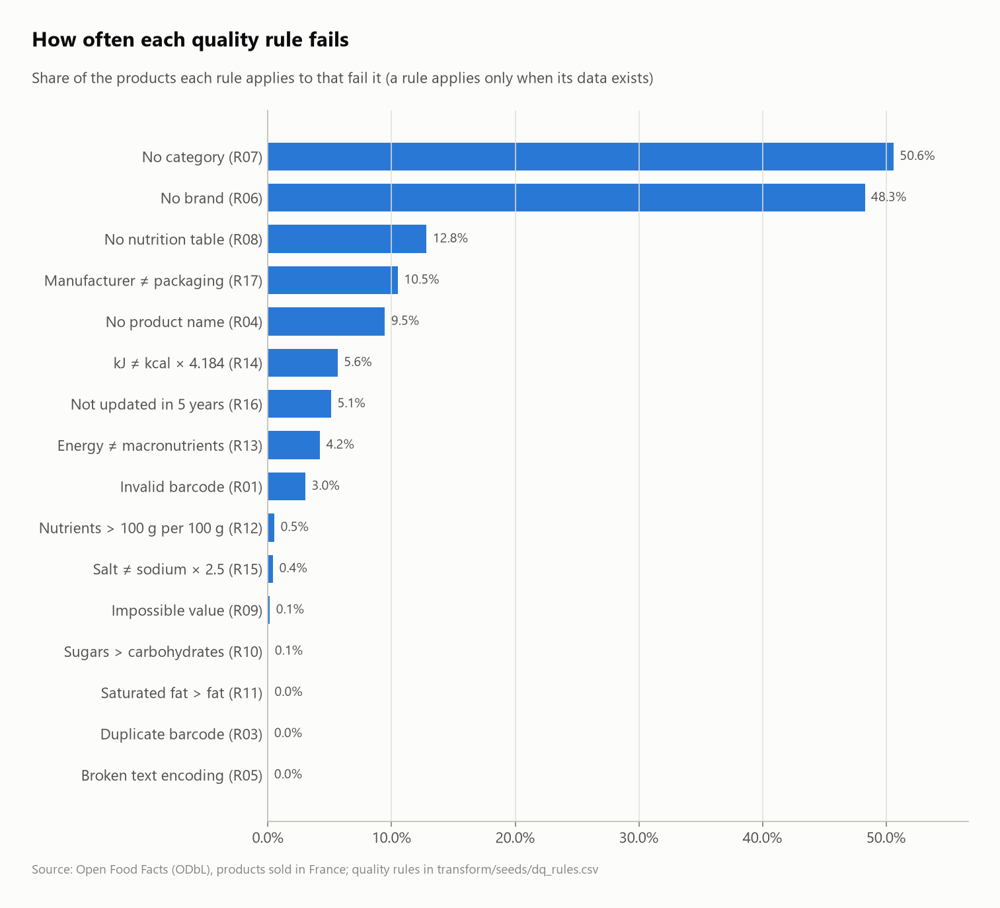
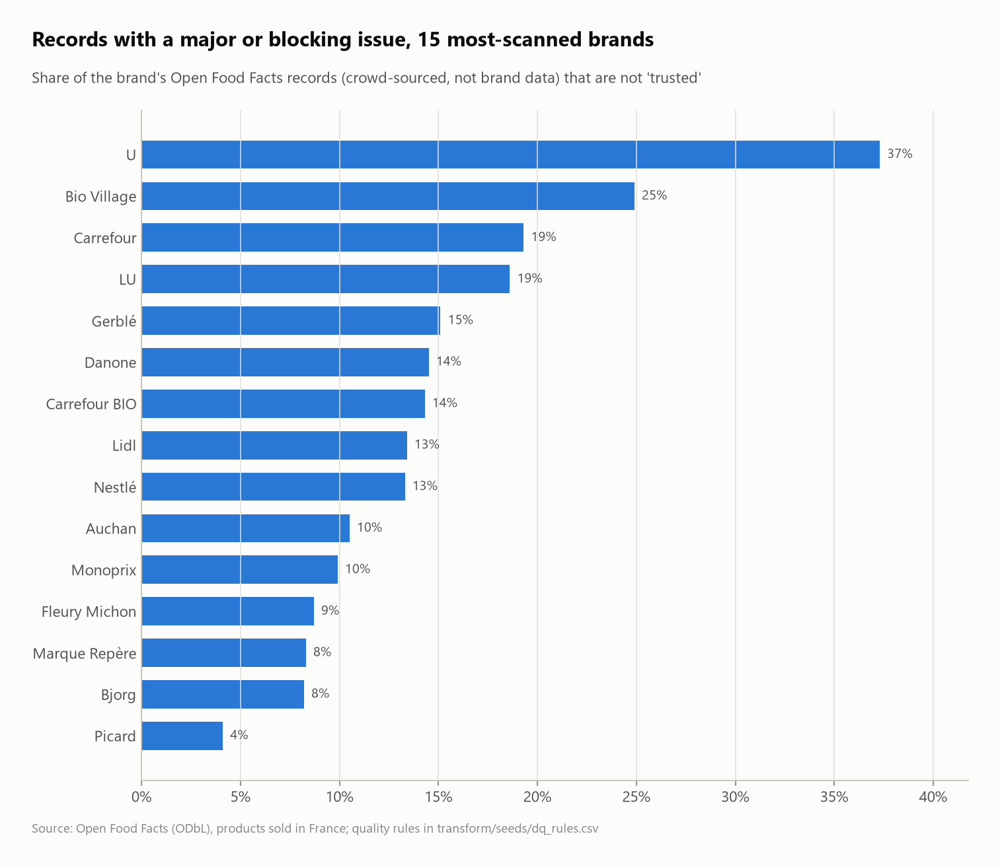
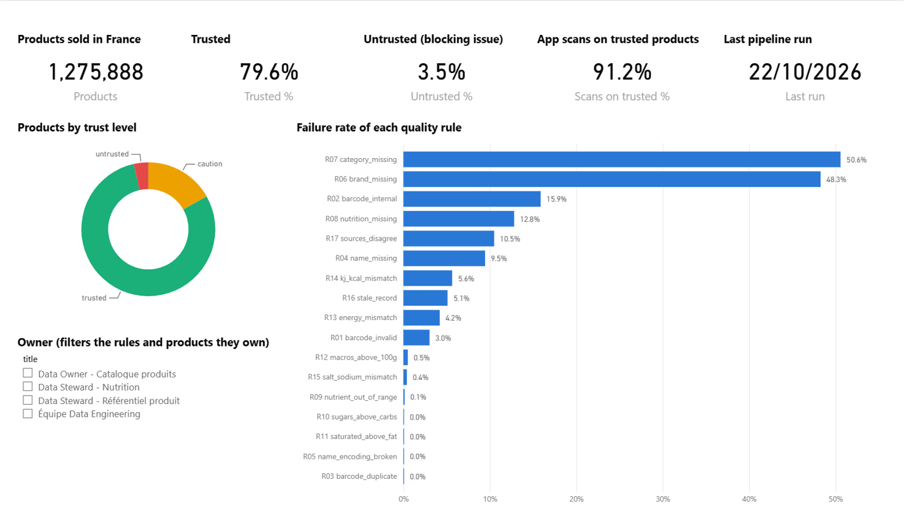
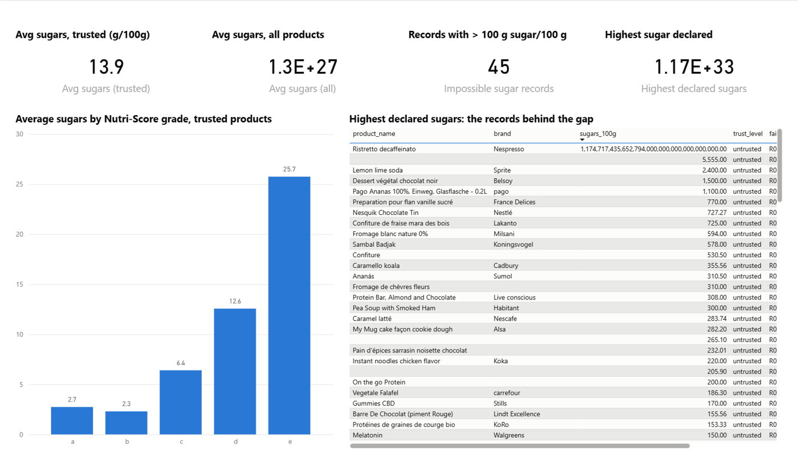

# Food data governance: quality rules, owners and a quality-aware AI agent

A data governance and quality layer on **1,275,888 food products sold in France**
([Open Food Facts](https://world.openfoodfacts.org), 4.8M products worldwide), with an AI
agent on top that answers questions in plain language **and says how reliable the data
behind each answer is**.

Seventeen business rules, each with a severity and an accountable owner, run on every
product at every pipeline run. Each product gets a trust level, only documented tables are
published, and the agent computes its figures on trusted data and says what it excluded.

**Stack:** Python · DuckDB · dbt (contracts, snapshots, incremental models, tests) · Claude
(Anthropic SDK) or a local open-source model (Ollama) · pytest



## Results

| Trust level | Products | Share | Share of app scans |
|---|---:|---:|---:|
| trusted (no major or blocking issue) | 1,016,235 | 79.6% | 91.2% |
| caution (at least one major issue) | 214,815 | 16.8% | 7.6% |
| untrusted (at least one blocking issue) | 44,838 | 3.5% | 1.2% |

The most-used records are the cleanest: products with issues carry 8.8% of the scans
but make up 20.4% of the catalogue.



| Rule | Severity | Checked | Failed | % |
|---|---|---:|---:|---:|
| R01 Invalid barcode (GS1 check digit) | blocking | 1,275,888 | 38,615 | 3.0% |
| R02 In-store barcode (GS1 restricted circulation) | info | 1,237,273 | 196,527 | 15.9% |
| R03 Same barcode with and without leading zeros | major | 1,275,888 | 2 | 0.0% |
| R04 No product name | major | 1,275,888 | 120,649 | 9.5% |
| R05 Broken text encoding in the name | major | 1,155,239 | 25 | 0.0% |
| R06 No brand | minor | 1,275,888 | 615,995 | 48.3% |
| R07 No category | minor | 1,275,888 | 645,430 | 50.6% |
| R08 No nutrition table (products not exempt by EU law) | major | 616,846 | 79,071 | 12.8% |
| R09 Impossible value (> 100 g per 100 g, > 900 kcal) | blocking | 921,625 | 1,362 | 0.15% |
| R10 Sugars above carbohydrates | blocking | 894,613 | 443 | 0.05% |
| R11 Saturated fat above fat | blocking | 892,244 | 248 | 0.03% |
| R12 Nutrients add up to more than 105 g per 100 g | blocking | 899,279 | 4,637 | 0.5% |
| R13 Energy ≠ energy recomputed from the macronutrients (±20%) | major | 899,255 | 37,818 | 4.2% |
| R14 kJ / kcal ratio outside 3.5–5.0 | minor | 882,382 | 49,802 | 5.6% |
| R15 Salt ≠ 2.5 × sodium | minor | 844,290 | 3,424 | 0.4% |
| R16 Not updated in 5 years | minor | 1,275,888 | 65,218 | 5.1% |
| R17 Manufacturer and packaging values disagree | major | 1,809 | 190 | 10.5% |

"Checked" counts only the products the rule applies to: a product without a sugar value
is not checked by "sugars ≤ carbohydrates", rather than counted as a pass.

### Findings

- **The same product, two truths.** The daily files carry one nutrient set per source.
  On the 1,809 products that have both a manufacturer set and a set typed in by a
  contributor from the packaging, **10.5% disagree**. Nutella's contributor set says
  60 g of sugar for 15 g of carbohydrates and 15 g of salt; the manufacturer says
  56.3 g and 0.107 g. Open Food Facts publishes the manufacturer's value, so the error
  never reaches the app: that is what a golden-record rule is for.
- **kJ typed as kcal.** 1,171 products have exactly the same number in kJ and in kcal,
  and 1,100 declare more than 900 kcal per 100 g, which even pure fat cannot reach.
  Gerblé wheat germ shows 1,587 kcal next to 1,572 kJ: the kJ value ended up in the
  kcal field, and anyone averaging energy per category gets it wrong.
- **15-digit barcodes.** 6,236 records have a 15-digit code, which no GTIN has; 4,754 of
  them are U (Système U) products, which is why U tops the brand chart below.
- **Half the catalogue has no brand or no category**, but those are mostly rarely scanned
  records: they carry about 9% of the scans.



These are Open Food Facts records, typed in by contributors or imported, not data published
by the brands themselves.

### Two rules I had to fix (the most useful lesson)

The first run flagged **14.8%** of products for "kJ ≠ 4.184 × kcal". Too many to be true.
Labels compute kJ and kcal *separately* from each nutrient with different EU factors
(fat 37 kJ / 9 kcal = 4.11, carbohydrates 17 / 4 = 4.25, fibre 8 / 2 = 4.0), so a correct
label has a ratio anywhere between 4.0 and 4.25. The rule now flags ratios outside
3.5–5.0: **5.6%**, and it still catches every kJ-typed-as-kcal case.

The first run also flagged mineral water for "no nutrition table". EU regulation 1169/2011
exempts water, alcoholic drinks, fresh fruit and vegetables, spices, salt, tea, coffee,
vinegar and honey. With the exemption, R08 went from 28.8% to **12.8%**.

A rule that fires too often is as harmful as one that never fires: people stop reading
the alerts. Both cases now have a regression test.

## Governance

| Asset | Where | What it holds |
|---|---|---|
| Rule registry | [`transform/seeds/dq_rules.csv`](transform/seeds/dq_rules.csv) | 17 rules: dimension, severity, owner, description |
| Owners | [`transform/seeds/data_owners.csv`](transform/seeds/data_owners.csv) | catalogue owner, product-reference steward, nutrition steward, data engineering |
| Glossary | [`transform/seeds/glossary.csv`](transform/seeds/glossary.csv) | agreed meaning of "product", "trusted", "blocking issue"… (in French) |
| Documentation | `schema.yml` files, `dbt docs generate` | every published column described, owner in `meta` |
| Lineage | dbt DAG + [exposures](transform/models/exposures.yml) | what the agent and the report depend on |
| Contract | `dq_rule_summary` | column names and types enforced at build time |
| Metrics | `dq_exclusion_reasons` | excluded products per rule, counted in products (a product can fail several rules) |
| History | `snapshots.products_snapshot` (SCD2), `gold.dq_history` | how each product, and each rule's failure rate, changes over time |
| Access | [`publish.py`](publish.py) → `serving.duckdb` | consumers see only tables marked `published` |
| Audit | `data/agent_audit.jsonl` | every query the agent ran |

## The agent

Two interchangeable versions with the same tools, instructions and guard rails:

- [`agent/agent.py`](agent/agent.py): Claude (`claude-opus-5-5`) through the Anthropic SDK's tool runner.
  Needs `ANTHROPIC_API_KEY`.
- [`agent/agent_local.py`](agent/agent_local.py): a local open-source model through Ollama
  (`qwen3:8b` by default). Free, offline: the data never leaves the machine.

Tools: `list_datasets`, `describe_dataset`, `run_sql`. Guard rails, tested in
[`tests/test_agent_tools.py`](tests/test_agent_tools.py):

- the database is opened read-only, with file and network access disabled;
- one `SELECT` per call (anything else is rejected), 50 rows at most;
- only published tables are visible;
- every query, accepted or rejected, is logged;
- every number in the answer is checked against the query results.

The instructions ([`agent/prompt.py`](agent/prompt.py)) make data quality part of every
answer: figures are computed on `trusted` products, and the answer says how many were left
out and why.

### What testing the local model taught me

Run on `qwen3:8b` (8B parameters, local GPU), the agent got the main figures right but
not always the rest:

| Attempt | Result | What changed |
|---|---|---|
| Reasoning on | right figures, wrong explanation: blamed "no brand" (a minor rule) for exclusions | told it which severities exclude a product |
| Reasoning off | 5x faster (25 s), but **invented numbers**: 20,000 "caution" products instead of 214,815 | reasoning back on: accuracy over speed |
| Reasons recomputed by the agent | **grain error**: summed rule failures (283,060) instead of counting products (259,653) | published a ready-made metric, `dq_exclusion_reasons`, instead of letting the agent recompute it |
| Final | right main figure, but one invented number in the side note | **number check in code** |

The last guard rail does not rely on the model: every number in the answer is compared
with the query results (directly, or as a sum, difference or percentage of them), and any
number the queries do not support is flagged under the answer:

```
La teneur moyenne en sucres des pâtes à tartiner (catégorie en:spreads) est de 29,02 g/100g,
calculée sur 38 468 produits trustés.
Fiabilité : ... (excluant 12 190 produits selon dq_exclusion_reasons.ALL) ...

⚠ Chiffres non vérifiés (absents des résultats de requête) : 12190
```

29.02 g and 38,468 are right; 12,190 was made up (5,612 spreads are excluded), and the
check caught it. A bigger model (Claude, `agent/agent.py`) makes fewer of these mistakes,
but the check runs on both.

## Power BI dashboard

[`powerbi/FoodDataQuality.pbip`](powerbi) is a Power BI project (text files: TMDL model + report),
generated by [`powerbi/build_pbip.py`](powerbi/build_pbip.py) from the Parquet files the pipeline
exports (`export_powerbi.py`), so the column types always match the data.

- **Model:** 7 tables, 6 relationships (rules and owners filter products through `product_issues`),
  measures in DAX (`Trusted %`, `Scans on trusted %`, `Avg sugars (trusted)`…), a `DataFolder` parameter.
- **Pages:** Overview · Why products are excluded · Brands · Products to fix (most-scanned first, filter by
  rule or owner) · Trusted vs all.
- **Refresh:** the data changes once a day, so the report is refreshed after each pipeline run
  (Home › Refresh). Open the `.pbip` in Power BI Desktop; the first open loads the data.





The "Trusted vs all" page shows why the trust level matters. The average sugar of trusted products is
13.9 g/100 g. Across all products it is 1.3 × 10²⁷ g/100 g, because a single record (a Nespresso
capsule declaring 1.17 × 10³³ g of sugar per 100 g) is enough to wreck a plain average. Rule R09
flags it, along with 44 other records declaring more than 100 g of sugar per 100 g.

## Run it

```bash
python -m venv .venv && .venv/Scripts/pip install -r requirements.txt
python run_pipeline.py                 # downloads the 8 GB export the first time, then ~3 min
python agent/agent_local.py "Quelles marques ont les données les moins fiables ?"
python -m pytest                       # 43 tests: every rule against a planted defect, agent guard rails
```

Every later run of `run_pipeline.py` loads only the new daily files, rebuilds, re-tests,
snapshots, and publishes. A failed step stops the run before anything is published.

## Limits

- R17 (sources disagree) can only be checked on products that came through a daily file:
  the full export holds only the published value, not the per-source sets.
- The nutrition exemption uses Open Food Facts categories, so a product without a category
  is never exempt.
- "Not updated in 5 years" is measured on the record, not on the product on the shelf.
- Brand figures describe Open Food Facts records, not the brands' own data.

Data: Open Food Facts, [Open Database License](https://opendatacommons.org/licenses/odbl/1-0/).
Design decisions explained in [LEARN.md](LEARN.md).
